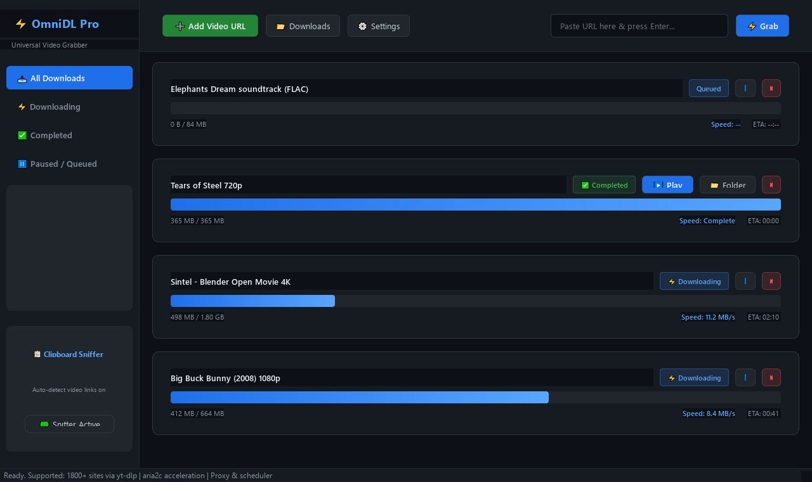

<div align="center">

# ⚡ OmniDL

**A free, open-source IDM alternative for Windows: download videos from 1800+ sites, with a browser grabber, turbo multi-connection downloads and a scheduler.**

[](https://github.com/noormdgolam/OmniDL/releases/latest)
[](LICENSE)


**[⬇ Download OmniDL-Pro.exe](https://github.com/noormdgolam/OmniDL/releases/latest)** · no install, no Python, no ads, no account



</div>

## Why

IDM costs money and only runs on Windows. Free alternatives are either command-line only (yt-dlp), or no longer
maintained. OmniDL puts [yt-dlp](https://github.com/yt-dlp/yt-dlp) behind a desktop app with the features people
actually buy IDM for: a browser button that catches the video, fast segmented downloads, a queue and a scheduler.

## Features

- **1800+ sites** through yt-dlp: YouTube (up to 8K, Shorts, playlists), Facebook, Instagram, TikTok, X/Twitter,
  Reddit, Vimeo, Twitch, Dailymotion, Bilibili, plus direct `.mp4` / `.m3u8` / `.mpd` links.
- **Browser grabber extension** (Edge / Chrome / Brave): catches the stream a page is playing, with the
  `Referer` / `Origin` headers it needs, and sends it to the app in one click.
- **Clipboard sniffer:** copy a video link anywhere and OmniDL offers to download it.
- **Turbo downloads:** up to 16 parallel fragments, optional [aria2c](https://aria2.github.io/) engine.
- **Quality picker:** best, 4K, 1080p, 720p, 480p, or audio only (MP3 320 kbps / FLAC).
- **Playlists and batches:** pick which items to download.
- **Queue and scheduler:** max parallel downloads, start at a set time, speed limits per time window,
  shutdown/sleep when done.
- **Network:** speed limit, HTTP/HTTPS/SOCKS5 proxy, auto-retry with back-off, resume.
- **Auto-sorting** into Video / Audio / Documents / Compressed / Programs / Images.

## OmniDL vs the usual options

| | OmniDL | IDM | yt-dlp (CLI) |
|---|---|---|---|
| Price | Free (GPL-3.0) | Paid | Free |
| Open source | ✅ | ❌ | ✅ |
| Desktop app | ✅ | ✅ | ❌ |
| Browser grab button | ✅ | ✅ | ❌ |
| Sites supported | 1800+ (yt-dlp) | Generic + popular | 1800+ |
| Playlists | ✅ | Limited | ✅ |
| Scheduler | ✅ | ✅ | ❌ |

## Quick start

**Option 1: the EXE (easiest).** Download `OmniDL-Pro.exe` from
[Releases](https://github.com/noormdgolam/OmniDL/releases/latest) and double-click it.
Windows SmartScreen may warn because the file is not code-signed: click *More info → Run anyway*.

**Option 2: from source** (Python 3.10+):

```bash
git clone https://github.com/noormdgolam/OmniDL.git
cd OmniDL
pip install -r requirements.txt
python main.py
```

For MP3/FLAC conversion and merging 1080p+ video with audio, install [FFmpeg](https://ffmpeg.org/download.html)
and keep it on your `PATH`.

**Browser grabber:** see [extension/README.md](extension/README.md). On Edge just run `launch_chrome_with_omnidl.bat`.

Downloads go to `%USERPROFILE%\Downloads\OmniDownloads` (change it in Settings).

## Build the EXE yourself

```bash
pip install -r requirements.txt pyinstaller
python build_exe.py      # -> OmniDL-Pro.exe
```

## Tests

```bash
pip install -r requirements.txt pytest
python -m pytest tests -q
```

Covers config, URL detection, a real local HTTP download checked by SHA-256, the UI, and the browser bridge.

## Contributing

Bug reports, site requests and pull requests are welcome; see [CONTRIBUTING.md](CONTRIBUTING.md).
If OmniDL saves you money, a ⭐ helps other people find it.

## Credits

Built on [yt-dlp](https://github.com/yt-dlp/yt-dlp) and [PyQt6](https://www.riverbankcomputing.com/software/pyqt/).
Feature ideas inspired by [FireDM](https://github.com/firedm/FireDM),
[Persepolis](https://github.com/persepolisdm/persepolis) and [PyIDM](https://github.com/pyIDM/PyIDM)
(re-implemented, no code copied).

## Legal

OmniDL is a general download tool. Only download content you own or have permission to download, and follow
each site's terms of service and your local copyright law. OmniDL does not remove DRM.

Licensed under the [GNU GPL v3.0](LICENSE).
